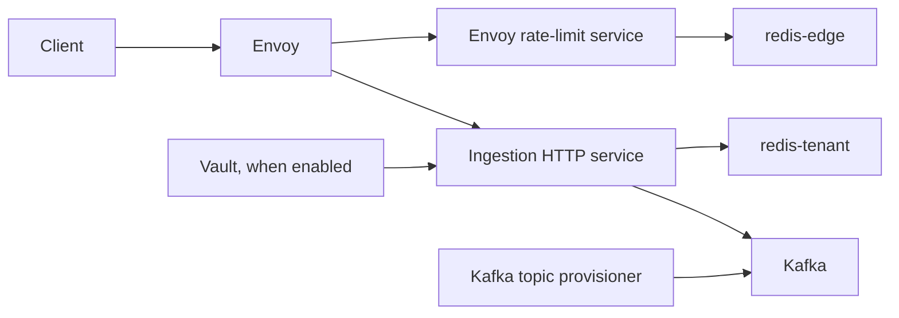

# Observa Architecture

## System context

Observa ingests application events from banking and fintech producer applications. The current
runtime accepts a single CloudEvents 1.0 structured JSON event, validates the Observa v1 profile,
attaches trusted tenant/source and ingestion metadata to the Kafka record headers, and publishes
the original request body to Kafka.

Terms such as tenant, source, event, category, and partition are defined in the
[glossary](docs/reference/glossary.md).

## Component boundaries

The diagram depicts `deploy/local/docker-compose.yml`,
`deploy/gateway/envoy.yaml`, `services/ingestion/cmd/ingestion/main.go`,
`services/ingestion/internal/platform/bootstrap/build.go`, and
`services/ingestion/internal/publisher/publisher.go`.

## Request lifecycle

1. A client sends `POST /v1/events` over HTTPS to Envoy.
2. Envoy validates the JWT against the configured issuer, audience, and remote JWKS.
3. Envoy maps JWT claims `tenant_id` and `source_id` to `X-Observa-Tenant` and
   `X-Observa-Source`; the plain-Envoy configuration does not forward the bearer token.
4. Envoy applies the shared edge rate limit through its external rate-limit service.
5. Ingestion requires `Content-Type: application/cloudevents+json`, enforces the configured
   body-size limit, parses one JSON value, and validates the event contract.
6. In authenticated mode, ingestion reads the trusted identity headers. Missing tenant or source
   identity returns `401`.
7. Ingestion checks the Redis-backed tenant quota. Limiter errors fail closed with `503`;
   exhausted quotas return `429`.
8. Ingestion creates an ingestion ID and received timestamp, derives the optional session ID,
   and publishes the original event bytes to the configured Kafka topic.
9. Ingestion returns `202` only after Kafka delivery confirmation. Publication that is not
   confirmed returns `503 publication_unconfirmed`.

The flow is evidenced by `deploy/gateway/envoy.yaml:33-77`,
`services/ingestion/internal/ingestion/handler.go:69-169`, and
`services/ingestion/internal/publisher/publisher.go:77-98`.

## Tenant isolation and Kafka partitioning

The gateway obtains tenant and source identity from verified JWT claims and forwards them as
`X-Observa-Tenant` and `X-Observa-Source` (`deploy/gateway/envoy.yaml:58-62`). In authenticated
mode the handler rejects missing values (`services/ingestion/internal/ingestion/handler.go:103-116`).
The tenant limiter hashes the tenant ID with SHA-256 before forming its Redis key:
`observa:ingestion:tenant-limit:v1:<hex-sha256>` (`services/ingestion/internal/ratelimit/limiter.go:119-123`).

Kafka record keys are `tenantID:sourceID` when no session ID is present and
`tenantID:sourceID:sessionID` when a session ID is present. The event ID is not part of the key
(`services/ingestion/internal/publisher/publisher.go:77-80`, `100-107`). This groups records
with the same tenant/source/session key onto the same Kafka partition under Kafka's keyed
partitioning behavior.

## Rate limiting

There are two independent Redis instances in the local Compose topology:
`redis-edge` backs the Envoy external rate-limit service and `redis-tenant` backs the Go
tenant limiter (`deploy/local/docker-compose.yml:6-56`, `70-94`, `158-165`).
The Envoy HTTP filter sets `failure_mode_deny: true` (`deploy/gateway/envoy.yaml:68-77`).
The tenant limiter fails startup if Redis cannot be pinged and returns an error when a quota
operation fails; the handler maps that error to `503` (`services/ingestion/internal/ratelimit/limiter.go:91-99`,
`108-134`; `services/ingestion/internal/ingestion/handler.go:118-136`).

## Delivery semantics

The producer requests all-ISR acknowledgements, configures ten record retries, and applies the
configured delivery and produce-request timeouts (`services/ingestion/internal/publisher/publisher.go:40-50`).
The implementation explicitly documents the boundary as at-least-once because a timeout can
leave the broker outcome ambiguous and a retry can duplicate a logical event. Consumers must
deduplicate by CloudEvents `event.id`; no consumer exists in this repository
(`services/ingestion/internal/ingestion/handler.go:154-159`).

## Out of Scope (Deferred)

The following capabilities are not implemented in the current codebase:

- Kafka consumer processing
- ClickHouse integration
- Apache Iceberg integration
- Object storage
- PostgreSQL integration
- OpenTelemetry tracing
- Prometheus metrics
