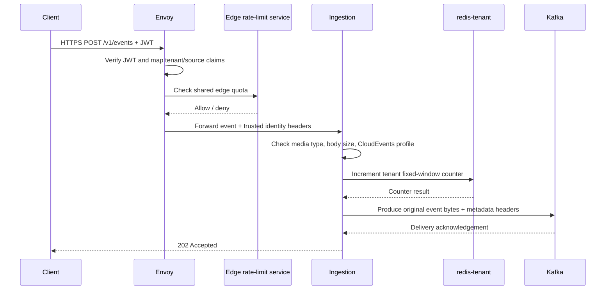

# High-Level Design

## Components

- **Envoy Gateway** terminates TLS, validates JWTs for `POST /v1/events`, maps trusted identity
  claims to headers, and invokes the shared edge rate-limit service.
- **Ingestion service** exposes the HTTP API, validates the event profile, applies a tenant quota,
  and publishes the original request bytes to Kafka.
- **Edge rate-limit service** serves Envoy's external rate-limit API and stores coarse counters in
  `redis-edge`.
- **Tenant quota** is implemented in the Go process through a Redis-backed fixed-window counter
  stored in `redis-tenant`.
- **Kafka** receives accepted event records.
- **Kafka topic provisioner** reconciles topic definitions from the YAML catalogue before the
  Compose ingestion container starts.
- **Vault** supplies Kafka SASL credentials only when `vault.enabled` is true.

The local Compose services and dependencies are defined in `deploy/local/docker-compose.yml`.
The ingestion executable and wiring are in `services/ingestion/cmd/ingestion/main.go` and
`services/ingestion/internal/platform/bootstrap/build.go`.

## Request flow

This sequence depicts `deploy/gateway/envoy.yaml`,
`services/ingestion/internal/ingestion/handler.go`,
`services/ingestion/internal/ratelimit/limiter.go`, and
`services/ingestion/internal/publisher/publisher.go`.

## Trust and isolation

The producer event does not carry tenant identity as a trusted field. Envoy verifies JWT claims
and forwards `tenant_id` and `source_id` as `X-Observa-Tenant` and `X-Observa-Source`
(`deploy/gateway/envoy.yaml:58-62`). The handler requires both in authenticated mode
(`services/ingestion/internal/ingestion/handler.go:103-116`). Tenant quota keys contain a
SHA-256 digest of the tenant ID, not the raw identifier
(`services/ingestion/internal/ratelimit/limiter.go:119-123`).

## Failure behavior

The edge Envoy HTTP filter has `failure_mode_deny: true`
(`deploy/gateway/envoy.yaml:68-77`). Tenant Redis must pass a startup ping, and runtime quota
errors are returned to the handler; the handler maps them to `503`
(`services/ingestion/internal/ratelimit/limiter.go:91-99`, `108-134`;
`services/ingestion/internal/ingestion/handler.go:118-136`). Kafka publication failure or
unconfirmed delivery maps to `503 publication_unconfirmed`
(`services/ingestion/internal/ingestion/handler.go:154-159`).

## Out of Scope (Deferred)

- Kafka consumer processing and DLQ consumption/replay
- ClickHouse integration
- Apache Iceberg and object-storage integration
- PostgreSQL integration
- OpenTelemetry tracing
- Prometheus metrics
